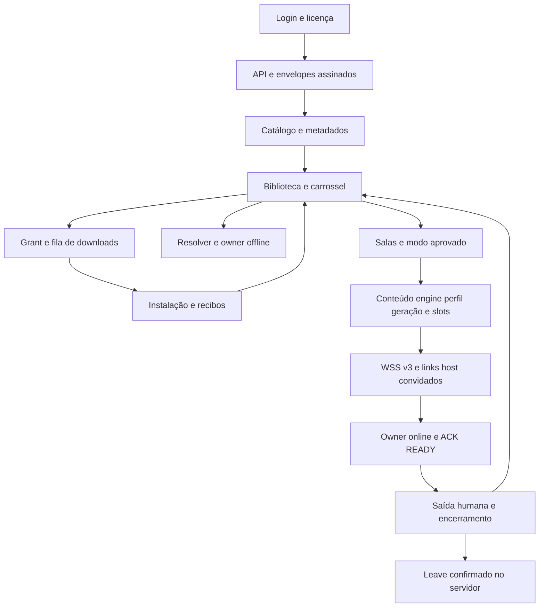

# TurboStations aplicativo completo e repasse de manutenção

## Atualização R135 em 12/10/2026

O dossiê e os inventários abaixo conservam a auditoria integral da base R134. A [entrega R135](../../versions/station-online-exit-r135-20261012/README.md) é o suplemento atual: correções solicitadas de saída em DEX35, compilação/assinatura, mapa de preservação e instalação comprovada no Edge 30, moto g52 e Samsung A56. O [estado R135](../../versions/station-online-exit-r135-20261012/STATUS.json) prevalece sobre os snapshots históricos de preparação abaixo. A abertura visual do moto g52 não foi observada com a tela apagada; gameplay com três aparelhos e aceite do servidor continuam pendentes.

## Auditoria integral R134 preservada

A referência instalada é o APK **R134**, fonte executável `4f9039eb9ce13907ce043870bfe1f6e294888556`, SHA256 `f8cb09184f41bc7c942ce84541dbd90d575b7240467ce0033d35be65e57caee2`. Edge 30 e Samsung A56 receberam os mesmos bytes, com assinatura e dados preservados. O proprietário relatou carregamento contínuo em uma partida com três pessoas e pedido para fechar o app ao sair do online. A qualificação do multiplayer para entrega ao consumidor está pendente.

## Leitura principal

- [Dossiê completo](DOSSIE-COMPLETO.md): aplicativo, serviços, telas, arquivos, emuladores, endpoints, multiplayer, compilação e operação.
- [Dossiê Word](TurboStations-Dossie-Completo-Auditoria-e-Handoff.docx): mesma redação consolidada para leitura e transferência.
- [Handoff de ativação R134](../../versions/station-settings-refinement-r134-20261011/HANDOFF-APP-R134-PARA-SERVIDOR-20261011.md): kit, registrador, modos e resposta administrativa exigida.
- [Auditoria e incidentes](AUDITORIA-E-INCIDENTES.md): defeitos comprovados, hipóteses e correções em fonte.
- [Overlay de lifecycle](../../integration/online-lifecycle-review-r135/README.md): alteração proposta, testes e estado da candidata. Não é APK instalado.
- [Revisão das verificações de compilação no GitHub](validation/CI-DELIVERY-REVIEW.json): correções de formatação e da conferência de migrações, sem alteração do banco produtivo.
- [Estado conferido em 12/10](validation/STATUS-CHECK-20261012.json): quatro verificações do servidor aprovadas, retorno operacional ainda sem confirmação, APK R134 instalado e candidata de correção sem APK.

## Inventários pesquisáveis

| Arquivo | Conteúdo |
| --- | --- |
| [java-source-composition.json](java-source-composition.json) | 281 fontes Java e camada de origem; ressalvas de transformações de bytecode |
| [java-methods.json](java-methods.json) | 3.650 declarações, classe, assinatura e linhas; 97 declarações native |
| [integration-build-source-index.json](integration-build-source-index.json) | Caminhos, tamanhos e hashes de fontes de integração e receitas anteriores ao overlay de lifecycle |
| [package-entries.json](package-entries.json) | Todas as 13.860 entradas do APK R134 com tamanho e hash do recibo final |
| [native-libraries.json](native-libraries.json) | 166 entradas de bibliotecas, incluindo assets Sony |
| [dex-entries.json](dex-entries.json) | 40 DEX principais e respectivos hashes; [asset PS4](dex-assets.json) registra a 41ª entrada |
| [dex-api-summary.json](dex-api-summary.json) | Todas as 51.615 definições de classes e 311.866 definições de métodos nas 41 entradas DEX: 40 principais e o owner PS4 em assets |
| [dex-defined-classes.json](dex-defined-classes.json) | Partição, descriptor e flags de cada classe definida |
| [dex-defined-methods.json.gz](dex-defined-methods.json.gz) | Assinaturas e flags de todos os métodos definidos, incluindo 2.001 declarações nativas; JSON comprimido |
| [productive-sources.json](productive-sources.json) | 13 arquivos do overlay produtivo R134 congelado |
| [sources.json](sources.json) | 107 referências do dossiê original, com caminho e URL quando disponíveis |
| [package-summary.json](package-summary.json) | Identidade do pacote e vínculos de compilação |
| [chapters.json](chapters.json) | Capítulos do aplicativo em formato estruturado |
| [consumer-review.json](consumer-review.json) | Operação, incidentes e gates de entrega ao consumidor |

Os índices permitem localizar funções; não constituem teste de todos os caminhos nem reconstrução integral de componentes de terceiros. O loop original do LibretroPlayer e algumas dependências compiladas têm limites de fonte expressos no dossiê. Os capítulos distinguem presença no APK, implementação, compilação, instalação e homologação.

## Arquitetura



## Reprodução dos documentos e índices

Na raiz do checkout, com Python e `python-docx` instalados:

```powershell
python tooling/handoff/render_dossier.py --input docs/handoff-completo-r134-20261011 --docx work/TurboStations-Dossie.docx --markdown work/DOSSIE-COMPLETO.md
python tooling/handoff/index_sources.py --repo . --out work/handoff-inventory --jdk CAMINHO_JDK17_BIN
python tooling/handoff/index_dex_api.py --apk APK_PRIVADO_R134 --entry-map docs/handoff-completo-r134-20261011/package-entries.json --out work/dex-inventory
```

O renderizador lê apenas os capítulos e inventários públicos. Para entregar o Word, renderizar e revisar todas as páginas depois de qualquer alteração. O indexador usa o parser de sintaxe do JDK; não resolve APIs Android nem roda o jogo.

## Receitas do aplicativo

- [Payloads R134](../../integration/settings-refinement-r134/recipe/README.md).
- [Pipeline e verificação de release](../../tooling/release/README.md).
- [Composição online PSX e overlays N64/Dolphin](../../integration/psx-online/).
- [Hosts Sony internos](../../integration/sony-internal/).
- [Matriz por edição e modo](../../audits/station-r134-online-mode-completion-20261011/README.md).

APKs, bibliotecas compiladas, mídias, jogos, BIOS, firmware, chaves e recibos privados originais não são enviados ao repositório público. Seus vínculos e necessidades estão documentados. O operador recebe o kit privado por um canal apropriado e deve confirmar seus bytes antes do cadastro. Publicação de Git não aplica a candidata ao servidor nem ao telefone.
